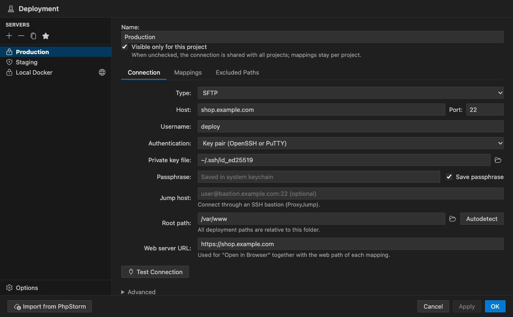
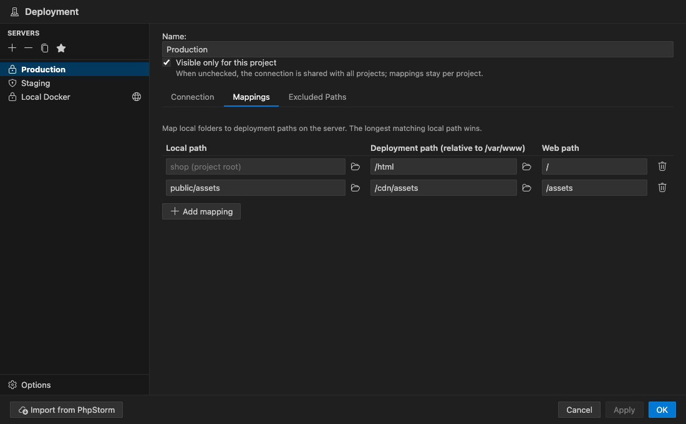
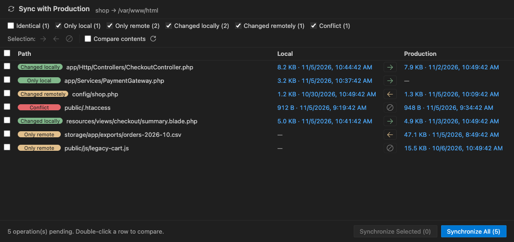

# iRemote — Deployment & Remote Host for VS Code

PhpStorm-style deployment for VS Code. Configure SFTP, FTP, FTPS, WebDAV or local/mounted servers with path mappings,
upload on save, browse and edit files directly on the server, compare, and synchronize — with the same concepts and
dialogs as PhpStorm's **Deployment** settings and **Remote Host** tool window.



| Path mappings | Sync with Deployed |
|---|---|
|  |  |

## Features

| PhpStorm | iRemote |
|---|---|
| Deployment settings (Connection / Mappings / Excluded Paths) | **Deployment Settings…** dialog with the same tabs |
| Server types SFTP, FTP, FTPS, WebDAV, Local or mounted folder | ✓ (FTPS explicit and implicit) |
| Default server, "Visible only for this project" | ✓ (unchecked = shared across projects, mappings stay per project) |
| Upload changed files automatically: Always / On explicit save / Never | ✓ |
| Skip external changes, delete remote files when local are deleted | ✓ |
| Warn when uploading over newer file (timestamp & size / content) | ✓ with **Overwrite / Compare / Skip** |
| Override file / folder permissions, preserve timestamps, create empty dirs | ✓ |
| Exclude items by name | ✓ (`.git;.idea;*.log` …) |
| Upload to… / Download from… / Compare with Deployed Version | ✓ (Explorer, editor and tab context menus → **Deployment**) |
| Sync with Deployed to… | ✓ side-by-side dialog with per-file direction |
| Remote Host tool window | ✓ browse, edit, create, rename, delete, chmod, drag & drop |
| Edit remote file | ✓ native editor via the `iremote://` file system; saving writes to the server |
| Notify about remote changes | ✓ open remote files are re-checked when VS Code regains focus |
| File Transfer tool window | ✓ panel with direction, progress, duration and errors |
| Import existing configuration | ✓ reads `.idea/deployment.xml`, `webServers.xml`, `sshConfigs.xml` |

### Security

- Passwords and key passphrases are stored in the OS keychain (VS Code SecretStorage), never in project files.
- SSH host keys are verified against `~/.ssh/known_hosts` (hashed entries, wildcards, `@revoked`) and keys you accepted;
  a changed host key shows a man-in-the-middle warning.
- TLS certificates (FTPS, WebDAV over HTTPS) are validated before any credentials are sent. Self-signed certificates
  are only accepted when *Allow untrusted certificates* is enabled and you confirm the fingerprint (it can be pinned).
- SSH: password, private key (OpenSSH/PuTTY, with passphrase), SSH agent, `~/.ssh/config` (HostName, User, Port,
  IdentityFile, ProxyJump), jump hosts and keyboard-interactive / 2FA prompts.

## Getting started

1. Open a folder, run **iRemote: Deployment Settings…** (or click the gear in the *Remote Host* view).
2. Click **+**, pick a server type, fill in the Connection tab and press **Test Connection**.
3. On the **Mappings** tab map a local folder to a deployment path (relative to the root path).
4. Mark the server as default (★) and choose an automatic upload mode in **Options**.

Already using PhpStorm? Run **iRemote: Import PhpStorm Deployment Configuration**.

## Configuration file

Settings are stored in `.vscode/iremote.json` (validated by a JSON schema). Example:

```json
{
  "version": 1,
  "defaultServer": "prod",
  "options": {
    "autoUpload": "onExplicitSave",
    "warnOnNewerRemote": "timestampAndSize",
    "excludeNames": [".git", ".idea", ".vscode", "node_modules", "*.log"]
  },
  "servers": [
    {
      "id": "prod",
      "name": "Production",
      "type": "sftp",
      "host": "example.com",
      "username": "deploy",
      "auth": "key",
      "privateKeyPath": "~/.ssh/id_ed25519",
      "rootPath": "/var/www",
      "webUrl": "https://example.com",
      "mappings": [{ "local": "", "remote": "/html", "web": "/" }],
      "excludedLocal": ["storage/logs"],
      "excludedRemote": ["/var/www/html/uploads"]
    }
  ]
}
```

## Settings

| Setting | Default | Description |
|---|---|---|
| `iremote.remoteHost.openBehavior` | `remote` | Open files from Remote Host directly on the server, or the local mapped copy when it exists. |
| `iremote.remoteHost.showHiddenFiles` | `true` | Show dot-files in Remote Host. |
| `iremote.ssh.knownHostsFiles` | `[]` | Extra known_hosts files (like OpenSSH `UserKnownHostsFile`); `~/.ssh/known_hosts` is always used. |
| `iremote.connection.timeoutSeconds` | `20` | Connection / command timeout. |
| `iremote.connection.idleCloseSeconds` | `300` | Close idle connections after this time. |
| `iremote.statusBar.enabled` | `true` | Default server and transfer status in the status bar. |
| `iremote.log.level` | `brief` | `errors`, `brief` or `details` (protocol trace) in the *iRemote* output channel. |

## Documentation

- [Configuration reference](https://github.com/mahbubur001/iremote/blob/main/docs/configuration.md) — every option in `.vscode/iremote.json`
- [Architecture](https://github.com/mahbubur001/iremote/blob/main/docs/architecture.md) — how the extension is put together
- [Development](https://github.com/mahbubur001/iremote/blob/main/docs/development.md) — building, test servers, CI

## Development

```bash
npm install
npm run build            # bundle extension + webviews into dist/
npm run watch            # rebuild on change (F5 launches the Extension Development Host)
npm test                 # typecheck + unit tests
npm run lint

npm run test:servers:up  # Docker: SFTP, FTP/FTPS (ProFTPD), FTP (vsftpd), WebDAV
npm run test:integration # protocol contract + deployer/sync tests against the containers
npm run test:e2e         # end-to-end inside VS Code (needs the containers)
npm run test:servers:down

npm run package          # produce iremote-<version>.vsix
```

### Setting up on a new machine

```bash
git clone git@github.com:mahbubur001/iremote.git && cd iremote
npm install
npm run build
npm run test:servers:up      # needs Docker Desktop running
code examples/demo           # demo project wired to the local test servers (user tester / password pass)
```

Press F5 in the `iremote` folder to run the extension from source, or `npm run package` and
`code --install-extension iremote-1.0.0.vsix` to install it.

### Architecture

```
src/
  protocol/   SFTP (ssh2), FTP/FTPS (basic-ftp), WebDAV (webdav), Local — one RemoteClient contract, no vscode imports
  core/       ConnectionPool, TransferQueue, PathMapper, StateCache, Deployer, SyncEngine, ServerManager
  config/     schema, normalization, ConfigStore, Credentials (keychain, known_hosts), PhpStorm importer
  fs/         iremote:// FileSystemProvider (direct remote editing)
  features/   AutoUploader, RemoteChangeMonitor
  views/      Remote Host tree, File Transfer view, status bar, decorations
  commands/   Deployment menu and Remote Host actions
  webviews/   Settings and Sync panels (extension side)
webview/      Settings and Sync UIs (browser side, plain TypeScript + VS Code theme variables)
```

## Known limitations

- Desktop VS Code only (raw TCP sockets are not available in vscode.dev).
- FTP active mode is not supported (passive / EPSV only).
- WebDAV cannot set permissions or modification times.
- Passwords stored by PhpStorm cannot be imported; you are asked once and can save them in the keychain.
